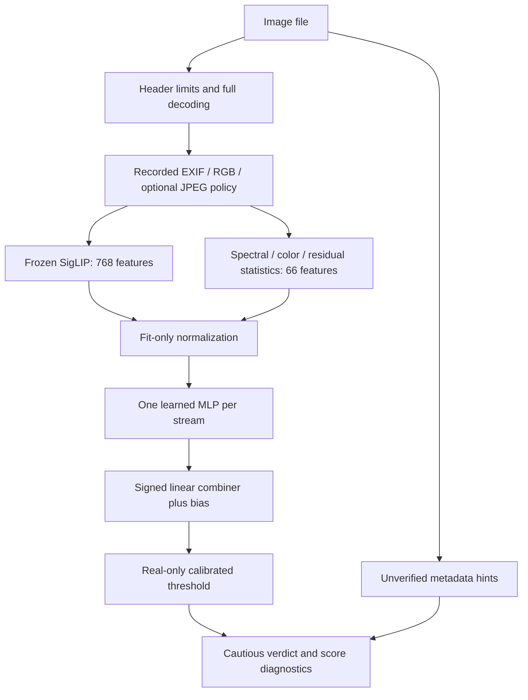

# Architecture and design rationale

## Two paths share one image contract

The diagram is the current two-stream model, not every historical experiment.
The offline synthetic example uses only the forensic branch to avoid foundation
downloads; it does not replace or benchmark this two-stream architecture.

Training caches and single-image inference must apply the same image policy,
backbone revision and processor configuration. A model fit to one feature
distribution must not silently receive another processor's vectors.

## Module contracts

| Component | Input → output | Responsibility |
|---|---|---|
| `preprocessing.py` | Pillow image + policy → RGB image | Pixel/frame bounds; recorded orientation and encoding policy |
| `backbones/siglip_encoder.py` | Prepared image batch → `[B,768]` | Credited pretrained, frozen semantic encoder |
| `backbones/forensic.py` | Prepared image batch → `[B,66]` | Candidate signal statistics, not proven fingerprints |
| `features/extract.py` | Manifest → versioned NPZ | Batched extraction, file identities, extractor metadata |
| `features/cache.py` | Features + identity metadata | Validate shape, row correspondence and finite values |
| `data/splits.py` | Identities/groups → partitions | Keep known related images out of competing roles |
| `models/fusion.py` | Normalized streams → score | Train heads; safe tensor loading; signed decomposition |
| `training.py` | Caches + config → fitted bundle | Separate fit, validation, real calibration, test |
| `calibration/` | Independent real scores → threshold | Set an operating rule without fake labels |
| `artifacts.py` | Model/calibrator/splits → verified bundle | Pairing, integrity, metadata and runtime checks |
| `inference.py` | Trusted bundle + image → verdict | Preserve training feature contract and decision semantics |
| `evaluation.py`, `parity.py` | Fixed model + inputs → checks | Separate performance from implementation equivalence |
| `app.py` | Temporary upload → diagnostics | Optional Gradio adapter; no silent external fallback |

`app.py` is an included interface, not a requirement to use the library and not
proof of which version runs on an external Space.

## Mathematics of the score

For stream `s`, let `x_s` be its feature vector. Standardize using **fit rows only**:

`z_s = (x_s - mu_s) / sigma_s`, where `sigma_s = fit_std_s + 1e-6`.

Each head produces a raw logit: `h_s = Linear(GELU(Linear(z_s)))`, with dropout
during fitting only. The final score is `f(x) = b + sum_s w_s h_s`. Combiner weights
may be negative. Displayed signed contribution is `w_s h_s`, not the unweighted
head logit. Contributions plus bias reconstruct the score; they are arithmetic
terms, not a causal explanation of manipulated pixels.

The fitting objective is mean binary cross-entropy with logits. If `y` is the
binary training label, one-example loss is
`max(f,0) - y*f + log(1 + exp(-abs(f)))`. This numerically stable form avoids
explicitly taking a logarithm of a nearly zero sigmoid. AdamW updates only the
heads in frozen-feature experiments. Replay adaptation uses explicit broad and
modern loss weights with separate role assignments.

## Threshold, abstention and probability differ

The binary decision is `f(x) > tau`; equality is not AI-positive. For `n`
exchangeable real calibration scores, use order rank
`ceil((n+1)*(1-alpha))`. If the rank exceeds `n`, a finite threshold is unavailable.
Deployment training requires sufficient calibration support rather than treating
an infinite cutoff as a usable detector.

The conformal statement is marginal over calibration and a fresh exchangeable
real draw. It is not a promise about every fitted threshold's realized FPR, nor
a guarantee under domain shift. The historical calibration field `certified`
records finite-threshold sample sufficiency, not deployment exchangeability.

The UI score-margin band is heuristic abstention, not calibrated uncertainty.
Neither a logit nor its sigmoid is a validated per-image AI probability here.
A below-threshold score does not prove camera origin.

## Design choices and trade-offs

- Frozen backbones make experiments cheap after extraction, but cannot learn
  missing representations during head-only adaptation.
- Handcrafted statistics add a different feature family, but camera processing,
  compression and editing can produce similar statistics. Ablation measures
  predictive association, not a generator-specific physical law.
- Caches improve iteration cost and reproducibility, but cannot recover missing
  original-image or preprocessing provenance from old vectors.
- Real-only calibration separates false alarms from detection power. Reducing
  false alarms can cost power; thresholds cannot fix every wrong score ordering.
- Identity/group checks reduce leakage but do not detect every near duplicate,
  shared prompt, edit relationship or acquisition shortcut.

## Failure boundaries and trust

Compressed-file and decoded-pixel limits are separate. Header checks and full
decoding occur before loading model weights. Inference additionally enforces the
bundle's own image policy. Animated/multi-frame inputs are unsupported.

Checksums detect accidental changes, not publisher authenticity. Tensor-only
loading avoids automatic unrestricted-pickle fallback. Joblib probes and explicit
legacy pickle still require trust. Finite weights, valid normalization, unique
stream specifications and encoder/head dimensions are checked.

There is no validated video detector, localized-edit detector, C2PA/SynthID
verifier or universal low-FPR frontier detector here. Those require separate
model/evaluation work; passing software tests is not such evidence.
